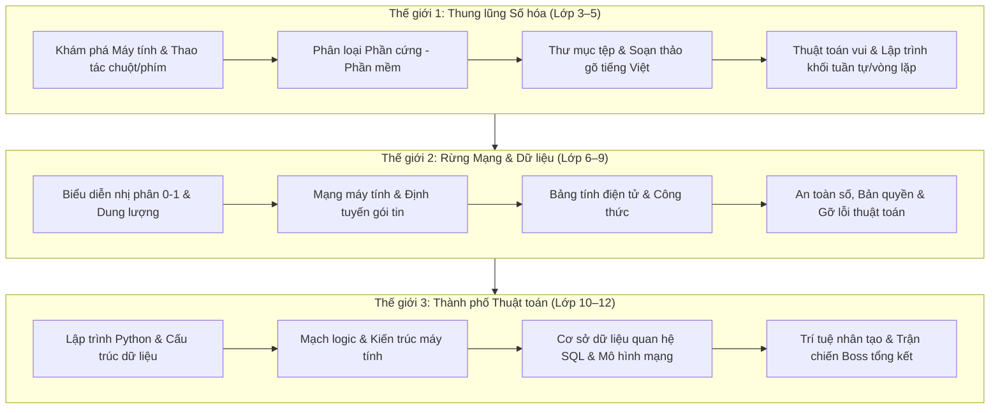

# 01b-curriculum-map.md — Bản đồ chương trình hợp nhất EasyTin

> **Phiên bản:** v1.0.0 (Đồng bộ khung GDPT 2018 & 3 bộ sách KNTT, Cánh Diều, CTST)  
> **Cấu trúc:** 7 Mạch kiến thức chuẩn (Chủ đề A -> G) xuyên suốt lớp 3 đến lớp 12.

---

## 1. Bảng thuật ngữ chuẩn hóa (Informatics Taxonomy)

| Thuật ngữ tiếng Việt | Thuật ngữ tiếng Anh | Định nghĩa chuẩn mực phổ thông | Quy ước trên EasyTin |
|---|---|---|---|
| **Phần cứng** | Hardware | Các linh kiện, thiết bị vật lý có thể nhìn thấy, sờ chạm được (CPU, RAM, màn hình, chuột, bàn phím). | `hardware` |
| **Phần mềm** | Software | Tập hợp các chương trình, chỉ thị máy tính điều khiển phần cứng thực hiện công việc (Hệ điều hành, Word, Scratch, Game). | `software` |
| **Thiết bị vào** | Input Device | Thiết bị tiếp nhận dữ liệu từ người dùng đưa vào máy tính (Chuột, bàn phím, micro, webcam, máy quét). | `input_device` |
| **Thiết bị ra** | Output Device | Thiết bị xuất dữ liệu đã xử lý từ máy tính cho người dùng (Màn hình, loa, máy in, máy chiếu). | `output_device` |
| **Bộ nhớ / Lưu trữ** | Storage | Nơi lưu trữ dữ liệu lâu dài hoặc tạm thời (RAM, ROM, SSD, Ổ cứng, USB, Thẻ nhớ). | `storage` |
| **Bit / Byte** | Bit / Byte | Đơn vị nhỏ nhất đo lượng thông tin (Bit: 0 hoặc 1; 1 Byte = 8 Bit). | `bit_byte` |
| **Thuật toán** | Algorithm | Dãy các chỉ dẫn rõ ràng, tuần tự từng bước để hoàn thành một nhiệm vụ hoặc giải quyết bài toán. | `algorithm` |
| **Tuần tự** | Sequence | Thực hiện các lệnh nối tiếp nhau theo thứ tự từ trên xuống dưới. | `sequence` |
| **Vòng lặp** | Loop / Iteration | Lặp lại một hoặc một khối lệnh nhiều lần thỏa mãn điều kiện xác định. | `loop` |
| **Rẽ nhánh** | Selection / Branching | Chọn lựa một nhánh công việc để thực thi dựa trên điều kiện đúng/sai. | `branching` |
| **Gói tin** | Packet | Đơn vị dữ liệu được đóng gói để truyền qua mạng Internet. | `packet` |
| **Địa chỉ IP** | IP Address | Nhãn số duy nhất gán cho mỗi thiết bị tham gia vào mạng máy tính. | `ip_address` |
| **Cổng logic** | Logic Gate | Khối xây dựng cơ bản của mạch điện tử số (AND, OR, NOT, XOR). | `logic_gate` |
| **Công dân số** | Digital Citizen | Người có kỹ năng, đạo đức và trách nhiệm khi tham gia vào thế giới số và mạng xã hội. | `digital_citizen` |

---

## 2. Cấu trúc 3 Thế giới Pixel trên EasyTin

---

## 3. Danh mục các Nút kiến thức cốt lõi (Core Curriculum Nodes)

| Node ID | Tên bài học trên EasyTin | Khối | Mạch GDPT 2018 | Khớp KNTT | Khớp Cánh Diều | Khớp CTST | Khuôn game |
|---|---|---|---|---|---|---|---|
| `G3-HARD-01` | Biệt đội Phần cứng Tí hon | 3 | Chủ đề A | Bài 3 | Bài 1 | Bài 2 | `sort-drag` |
| `G3-MOUSE-01` | Bậc thầy Chuột máy tính | 3 | Chủ đề A | Bài 4 | Bài 3 | Bài 3 | `sort-drag` |
| `G3-KEY-01` | Đua tốc độ Bàn phím | 3 | Chủ đề A | Bài 5 | Bài 4 | Bài 4 | `type-run` |
| `G3-ALGO-01` | Robot Vượt mê cung lệnh | 3 | Chủ đề F | Bài 14 | Bài 1 | Bài 12 | `block-maze` |
| `G4-HARD-01` | Phân loại Phần cứng & Phần mềm | 4 | Chủ đề A | Bài 1 | Bài 1 | Bài 1 | `sort-drag` |
| `G4-ETHIC-01` | Hiệp sĩ An toàn số | 4 | Chủ đề D | Bài 5 | Bài 2 | Bài 4 | `branch-story` |
| `G4-ALGO-01` | Vũ điệu Vòng lặp Pixel | 4 | Chủ đề F | Bài 14 | Bài 1 | Bài 13 | `block-maze` |
| `G5-DATA-01` | Bách khoa Tệp và Thư mục | 5 | Chủ đề C | Bài 3 | Bài 2 | Bài 2 | `sort-drag` |
| `G6-BIN-01` | Thế giới Số nhị phân 0 & 1 | 6 | Chủ đề A | Bài 3 | Bài 3 | Bài 3 | `logic-puzzle` |
| `G6-NET-01` | Hành trình Gói tin Internet | 6 | Chủ đề B | Bài 4 | Bài 2 | Bài 2 | `packet-route` |
| `G7-SHEET-01` | Bảng tính diệu kỳ | 7 | Chủ đề E | Bài 6 | Bài 4 | Bài 5 | `sheet-quest` |
| `G8-BUG-01` | Thợ săn Lỗi thuật toán | 8 | Chủ đề F | Bài 11 | Bài 3 | Bài 11 | `bug-hunt` |
| `G9-CYBER-01` | Tường lửa Phòng vệ Mạng | 9 | Chủ đề D | Bài 2 | Bài 1 | Bài 3 | `branch-story` |
| `G10-PY-01` | Đấu sĩ Python: Cú pháp & Biến | 10 | Chủ đề F | Bài 16 | Bài 1 | Bài 16 | `py-sandbox` / `bug-hunt` |
| `G10-GATE-01` | Cổng logic & Bảng chân trị | 10 | Chủ đề A (CS) | Bài 4 | Bài 4 | Bài 4 | `logic-puzzle` |
| `G11-SORT-01` | Vũ hội Sắp xếp Dữ liệu | 11 | Chủ đề F (CS) | Bài 14 | Bài 3 | Bài 14 | `bug-hunt` / `logic-puzzle` |
| `G12-BOSS-01` | Trận đại chiến Trùm AI & Mạng | 12 | Toàn diện | Tổng kết | Tổng kết | Tổng kết | `boss-quiz` |
