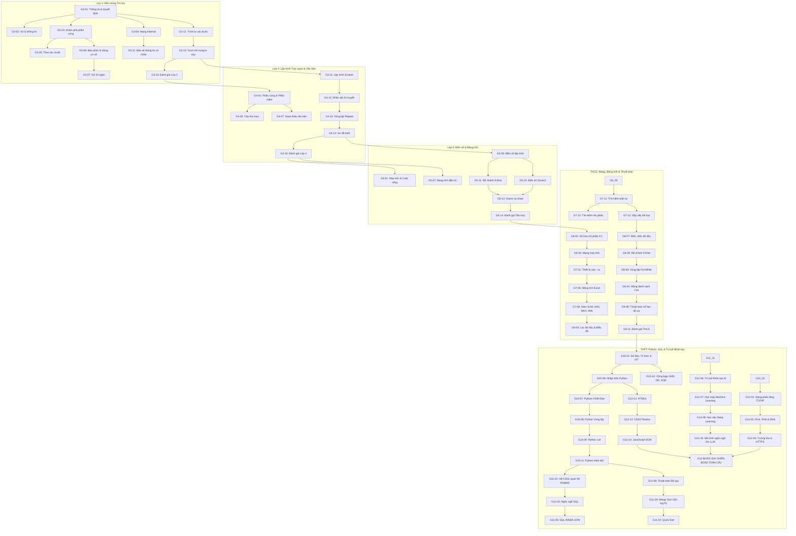

# 01b-curriculum-map.md — Bản đồ chương trình hợp nhất toàn diện EasyTin (Lớp 3–12)

> **Phiên bản:** v2.1.0 (Đồng bộ toàn diện Khung GDPT 2018 theo Thông tư 32/2018/TT-BGDĐT)  
> **Độ phủ:** 100% bài học của cả 3 bộ sách: **Kết nối tri thức với cuộc sống**, **Cánh Diều**, **Chân trời sáng tạo**.  
> **Tổng số nút học tập:** **137 bài học tương tác** trải dài từ Lớp 3 đến Lớp 12 qua 3 Thế giới Pixel.

---

## 1. Bảng tổng hợp số lượng bài học theo khối lớp

| Khối lớp | Cấp học | Thế giới Pixel | Số bài học EasyTin | Phủ KNTT | Phủ Cánh Diều | Phủ CTST |
| :--- | :--- | :--- | :--- | :--- | :--- | :--- |
| Lớp  3 | Tiểu học | Thung lũng Số hóa (W1) | **14 bài** | 100% (đầy đủ) | 100% (đầy đủ) | 100% (đầy đủ) |
| Lớp  4 | Tiểu học | Thung lũng Số hóa (W1) | **15 bài** | 100% (đầy đủ) | 100% (đầy đủ) | 100% (đầy đủ) |
| Lớp  5 | Tiểu học | Thung lũng Số hóa (W1) | **14 bài** | 100% (đầy đủ) | 100% (đầy đủ) | 100% (đầy đủ) |
| Lớp  6 | THCS | Rừng Mạng & Dữ liệu (W2) | **12 bài** | 100% (đầy đủ) | 100% (đầy đủ) | 100% (đầy đủ) |
| Lớp  7 | THCS | Rừng Mạng & Dữ liệu (W2) | **14 bài** | 100% (đầy đủ) | 100% (đầy đủ) | 100% (đầy đủ) |
| Lớp  8 | THCS | Rừng Mạng & Dữ liệu (W2) | **13 bài** | 100% (đầy đủ) | 100% (đầy đủ) | 100% (đầy đủ) |
| Lớp  9 | THCS | Rừng Mạng & Dữ liệu (W2) | **11 bài** | 100% (đầy đủ) | 100% (đầy đủ) | 100% (đầy đủ) |
| Lớp 10 | THPT | Thành phố Thuật toán (W3) | **15 bài** | 100% (đầy đủ) | 100% (đầy đủ) | 100% (đầy đủ) |
| Lớp 11 | THPT | Thành phố Thuật toán (W3) | **14 bài** | 100% (đầy đủ) | 100% (đầy đủ) | 100% (đầy đủ) |
| Lớp 12 | THPT | Thành phố Thuật toán (W3) | **15 bài** | 100% (đầy đủ) | 100% (đầy đủ) | 100% (đầy đủ) |
| **TỔNG CỘNG** | **3 Cấp học** | **3 Thế giới** | **137 bài** | **100%** | **100%** | **100%** |

---

## 2. Thống kê phân bổ 8 khuôn Game Pixel tương tác

| Khuôn Game | Nhóm năng lực rèn luyện | Số bài áp dụng | Tỉ lệ (%) |
| :--- | :--- | :--- | :--- |
| `sort-drag` | Phân loại khái niệm, phần cứng, tệp tin, dữ liệu | **38 bài** | 27.7% |
| `branch-story` | Đạo đức số, bản quyền, an ninh mạng, ra quyết định | **23 bài** | 16.8% |
| `logic-puzzle` | Cổng logic, bit nhị phân, công thức bảng tính, SQL | **23 bài** | 16.8% |
| `bug-hunt` | Phát hiện lỗi cú pháp, lỗi thời gian chạy và gỡ lỗi thuật toán | **14 bài** | 10.2% |
| `block-maze` | Tư duy điều khiển thuật toán, vòng lặp, di chuyển robot | **12 bài** | 8.8% |
| `boss-quiz` | Thử thách tổng kết và đánh giá năng lực khối lớp | **10 bài** | 7.3% |
| `match-memory` | Ghi nhớ thuật ngữ chuyên ngành, ghép nối định nghĩa | **10 bài** | 7.3% |
| `type-run` | Luyện gõ bàn phím mười ngón, cú pháp Python, HTML | **7 bài** | 5.1% |

---

## 3. Ma trận đối chiếu chi tiết 137 Nút bài học EasyTin × 3 Bộ sách

### Lớp 3 — (14 bài học)

| Node ID | Tên bài học EasyTin | Mạch GDPT 2018 | Bài học KNTT tương ứng | Bài học Cánh Diều tương ứng | Bài học CTST tương ứng | Khuôn Game |
| :--- | :--- | :--- | :--- | :--- | :--- | :--- |
| `G3-01` | **Thông tin và Quyết định Cuộc sống** | Chủ đề A: Máy tính và em | Bài 1: Thông tin và quyết định | Bài 1: Em làm quen với máy tính | Bài 1: Thông tin và tiếp nhận thông tin | `branch-story` |
| `G3-02` | **Xử lý Thông tin & Các dạng Dữ liệu** | Chủ đề A: Máy tính và em | Bài 2: Xử lý thông tin | Bài 2: Các bộ phận của máy tính | Bài 1: Thông tin và tiếp nhận thông tin | `sort-drag` |
| `G3-03` | **Khám phá Phần cứng & Bộ phận Máy tính** | Chủ đề A: Máy tính và em | Bài 3: Máy tính - những người bạn mới | Bài 2: Các bộ phận của máy tính | Bài 2: Khám phá máy tính | `sort-drag` |
| `G3-04` | **Làm việc với Máy tính An toàn** | Chủ đề A: Máy tính và em | Bài 4: Làm việc với máy tính | Bài 1: Em làm quen với máy tính | Bài 2: Khám phá máy tính | `branch-story` |
| `G3-05` | **Luyện tập Thao tác Chuột Máy tính Chuẩn xác** | Chủ đề A: Máy tính và em | Bài 6: Sử dụng chuột máy tính | Bài 3: Em tập dùng chuột | Bài 3: Em tập sử dụng chuột | `sort-drag` |
| `G3-06` | **Làm quen Bàn phím & Hàng phím Cơ sở** | Chủ đề A: Máy tính và em | Bài 5: Sử dụng bàn phím | Bài 4: Em tập gõ hàng phím cơ sở | Bài 4: Em tập sử dụng bàn phím | `type-run` |
| `G3-07` | **Mở rộng Kỹ năng Gõ mười ngón** | Chủ đề E: Ứng dụng tin học | Bài 12: Em tập gõ bàn phím | Bài 5: Em tập gõ các hàng phím khác | Bài 9: Phần mềm luyện gõ phím | `type-run` |
| `G3-08` | **Khám phá Thế giới Mạng Internet** | Chủ đề B: Mạng và Internet | Bài 7: Khám phá Internet | Bài 6: Thông tin trên Internet | Bài 5: Khám phá Internet | `branch-story` |
| `G3-09` | **Sắp xếp Phân loại Đồ vật & Thông tin** | Chủ đề C: Tổ chức lưu trữ | Bài 8, 9: Sắp xếp để dễ tìm | Bài 7: Sắp xếp đồ vật hợp lí | Bài 6: Sắp xếp và phân loại thông tin | `sort-drag` |
| `G3-10` | **Sơ đồ Cây & Biểu diễn Phân cấp** | Chủ đề C: Tổ chức lưu trữ | Bài 10: Sơ đồ tư duy | Bài 8: Sơ đồ hình cây | Bài 7: Sơ đồ phân loại đồ vật | `logic-puzzle` |
| `G3-11` | **Bảo vệ Thông tin Bí mật Cá nhân** | Chủ đề D: Đạo đức, pháp luật | Bài 11: Lưu trữ và trao đổi thông tin | Bài 9: Em bảo vệ thông tin cá nhân | Bài 8: Bảo vệ dữ liệu cá nhân | `branch-story` |
| `G3-12` | **Trình tự các bước & Thuật toán Hành động** | Chủ đề F: Giải quyết vấn đề | Bài 14, 15: Công việc theo các bước | Bài 12, 13: Chia việc & Làm theo bước | Bài 11, 12: Trình tự công việc | `block-maze` |
| `G3-13` | **Vượt Mê cung & Trò chơi Rèn luyện Tư duy** | Chủ đề F: Giải quyết vấn đề | Bài 16: Trò chơi học tập | Bài 14, 15: Giải bài toán bằng sơ đồ | Bài 13, 14: Trò chơi tư duy mê cung | `block-maze` |
| `G3-14` | **Ôn tập & Đánh giá Năng lực Tin học Lớp 3** | Tổng kết GDPT 2018 Lớp 3 | Bài 16: Tổng kết Tin học 3 | Bài 16: Em tập trình bày ý kiến | Bài 15, 16: Đánh giá & Dự án Tin học | `boss-quiz` |

### Lớp 4 — (15 bài học)

| Node ID | Tên bài học EasyTin | Mạch GDPT 2018 | Bài học KNTT tương ứng | Bài học Cánh Diều tương ứng | Bài học CTST tương ứng | Khuôn Game |
| :--- | :--- | :--- | :--- | :--- | :--- | :--- |
| `G4-01` | **Phần cứng & Phần mềm Máy tính** | Chủ đề A: Máy tính và em | Bài 1: Phần cứng và phần mềm máy tính | Bài 1: Phần cứng và phần mềm | Bài 1: Phần cứng và phần mềm | `sort-drag` |
| `G4-02` | **Luyện gõ Mười ngón & Tiếng Việt Telex** | Chủ đề A: Máy tính và em | Bài 2: Gõ bàn phím đúng cách | Bài 2: Luyện tập gõ mười ngón | Bài 2: Rèn luyện kỹ năng gõ phím | `type-run` |
| `G4-03` | **Thông tin trên Web & Siêu liên kết** | Chủ đề B: Mạng và Internet | Bài 3: Thông tin trên trang web | Bài 3: Khám phá trang web | Bài 3: Tìm kiếm an toàn trên Internet | `branch-story` |
| `G4-04` | **Kỹ năng Tìm kiếm Thông tin Khoa học** | Chủ đề B: Mạng và Internet | Bài 4: Tìm kiếm thông tin trên Internet | Bài 4: Tìm kiếm thông tin hữu ích | Bài 3: Tìm kiếm an toàn trên Internet | `sort-drag` |
| `G4-05` | **Quản lý Tệp và Cây Thư mục Khoa học** | Chủ đề C: Tổ chức lưu trữ | Bài 5: Thao tác với tệp và thư mục | Bài 5: Quản lý tệp và thư mục | Bài 4: Quản lý tệp và thư mục | `sort-drag` |
| `G4-06` | **Bản quyền Tác giả & Đạo đức Phần mềm** | Chủ đề D: Đạo đức, pháp luật | Bài 6: Sử dụng phần mềm khi được phép | Bài 6: Tôn trọng quyền tác giả | Bài 5: Bản quyền và thông tin hợp pháp | `branch-story` |
| `G4-07` | **Soạn thảo Văn bản & Chèn Hình ảnh** | Chủ đề E: Ứng dụng tin học | Bài 7: Chèn hình ảnh vào văn bản | Bài 7: Soạn thảo văn bản có hình ảnh | Bài 6: Chèn hình và căn lề văn bản | `sort-drag` |
| `G4-08` | **Định dạng Đoạn Văn bản Chuyên nghiệp** | Chủ đề E: Ứng dụng tin học | Bài 8: Định dạng văn bản | Bài 8: Định dạng đoạn văn bản | Bài 7: Định dạng kiểu chữ và màu sắc | `type-run` |
| `G4-09` | **Thiết kế Bài Trình chiếu Sinh động** | Chủ đề E: Ứng dụng tin học | Bài 9, 10: Tạo bài trình chiếu | Bài 9, 10: Phần mềm trình chiếu | Bài 8, 9: Trang trình chiếu & Báo cáo | `match-memory` |
| `G4-10` | **Xử lý & Chỉnh sửa Hình ảnh Cơ bản** | Chủ đề E: Ứng dụng tin học | Bài 11: Chỉnh sửa hình ảnh | Bài 11: Xử lý hình ảnh đơn giản | Bài 10: Chỉnh sửa ảnh cơ bản | `sort-drag` |
| `G4-11` | **Khám phá Lập trình Trực quan Scratch** | Chủ đề F: Giải quyết vấn đề | Bài 12, 13: Môi trường Scratch & Lệnh đầu tiên | Bài 12: Em làm quen với Scratch | Bài 11, 12: Môi trường & Nhân vật | `match-memory` |
| `G4-12` | **Điều khiển Nhân vật Chuyển động** | Chủ đề F: Giải quyết vấn đề | Bài 14: Điều khiển nhân vật chuyển động | Bài 13: Nhân vật chuyển động theo lệnh | Bài 13: Điều khiển nhân vật di chuyển | `block-maze` |
| `G4-13` | **Cấu trúc Vòng lặp Tuần hoàn (Repeat)** | Chủ đề F: Giải quyết vấn đề | Bài 15: Lặp lại một việc | Bài 14: Cấu trúc lặp trong lập trình | Bài 14: Vòng lặp trong chương trình | `block-maze` |
| `G4-14` | **Biểu diễn Thuật toán bằng Sơ đồ khối** | Chủ đề F: Giải quyết vấn đề | Bài 16: Biểu diễn thuật toán | Bài 15: Xây dựng câu chuyện tương tác | Bài 15: Sơ đồ khối thuật toán | `logic-puzzle` |
| `G4-15` | **Ôn tập & Đánh giá Năng lực Tin học Lớp 4** | Tổng kết GDPT 2018 Lớp 4 | Bài 16: Dự án Tin học 4 | Bài 16: Dự án lập trình trò chơi | Bài 16: Dự án Em làm nhà lập trình | `boss-quiz` |

### Lớp 5 — (14 bài học)

| Node ID | Tên bài học EasyTin | Mạch GDPT 2018 | Bài học KNTT tương ứng | Bài học Cánh Diều tương ứng | Bài học CTST tương ứng | Khuôn Game |
| :--- | :--- | :--- | :--- | :--- | :--- | :--- |
| `G5-01` | **Máy tính và Cuộc sống Hiện đại** | Chủ đề A: Máy tính và em | Bài 1: Máy tính và cuộc sống | Bài 1: Vai trò máy tính thời đại số | Bài 1: Thiết bị thông minh quanh em | `match-memory` |
| `G5-02` | **Khám phá Phần cứng bên trong Thân máy** | Chủ đề A: Máy tính và em | Bài 2: Khám phá phần cứng máy tính | Bài 1: Các bộ phận máy tính | Bài 1: Khám phá phần cứng | `sort-drag` |
| `G5-03` | **An toàn Điện, Bảo vệ Mắt & Tiết kiệm Điện** | Chủ đề A: Máy tính và em | Bài 3: Sử dụng máy tính an toàn, tiết kiệm điện | Bài 2: An toàn thông tin và sức khỏe | Bài 2: An toàn trực tuyến | `branch-story` |
| `G5-04` | **Thẩm định Độ tin cậy Thông tin trên Mạng** | Chủ đề B: Mạng và Internet | Bài 4: Tìm kiếm thông tin trên Internet | Bài 3: Tìm kiếm và đánh giá thông tin | Bài 3: Đánh giá độ tin cậy thông tin | `sort-drag` |
| `G5-05` | **Bản quyền Số & Trách nhiệm Chia sẻ** | Chủ đề D: Đạo đức, pháp luật | Bài 5: Bản quyền và thông tin an toàn | Bài 4: Bản quyền và đạo đức trên mạng | Bài 4: Tôn trọng quyền riêng tư & trí tuệ | `branch-story` |
| `G5-06` | **Soạn thảo Nâng cao & Chèn Bảng biểu** | Chủ đề E: Ứng dụng tin học | Bài 6, 7: Định dạng nâng cao & Thực hành | Bài 7: Soạn thảo văn bản nâng cao | Bài 6: Soạn thảo chèn bảng biểu | `sort-drag` |
| `G5-07` | **Bảng tính Điện tử & Tổ chức Dữ liệu** | Chủ đề E: Ứng dụng tin học | Bài 8: Thu thập và sắp xếp dữ liệu | Bài 5, 6: Thu thập & Xử lý dữ liệu | Bài 5: Bảng tính & Dữ liệu | `sort-drag` |
| `G5-08` | **Thiết kế Bài Trình chiếu Đa phương tiện** | Chủ đề E: Ứng dụng tin học | Bài 9, 10: Trình chiếu đa phương tiện | Bài 8: Bài trình chiếu đa phương tiện | Bài 7: Thiết kế thuyết trình | `sort-drag` |
| `G5-09` | **Khái niệm Biến số trong Lập trình** | Chủ đề F: Giải quyết vấn đề | Bài 11: Làm quen với biến trong lập trình | Bài 9: Giới thiệu biến số Scratch | Bài 8: Biến số & Lưu trữ dữ liệu | `logic-puzzle` |
| `G5-10` | **Lập trình Biến số & Tính điểm trong Scratch** | Chủ đề F: Giải quyết vấn đề | Bài 12: Sử dụng biến trong Scratch | Bài 10: Sử dụng biến để đếm điểm | Bài 9: Thực hành tính toán biến số | `block-maze` |
| `G5-11` | **Cấu trúc Điều kiện Rẽ nhánh (If - Else)** | Chủ đề F: Giải quyết vấn đề | Bài 13: Cấu trúc rẽ nhánh | Bài 11, 12: Điều kiện Nếu... Thì... | Bài 10, 11: Rẽ nhánh thuật toán | `logic-puzzle` |
| `G5-12` | **Thực hành Lập trình Game Rẽ nhánh & Va chạm** | Chủ đề F: Giải quyết vấn đề | Bài 14, 15: Tạo chương trình rẽ nhánh & Trò chơi | Bài 13, 14: Game mê cung & Đối kháng | Bài 12, 14: Vòng lặp rẽ nhánh & Đố vui | `block-maze` |
| `G5-13` | **Phát hiện & Gỡ lỗi (Debugging) Chương trình** | Chủ đề F: Giải quyết vấn đề | Bài 16: Ôn tập và kiểm thử | Bài 15: Kiểm thử và sửa lỗi | Bài 13: Phát hiện và sửa lỗi | `bug-hunt` |
| `G5-14` | **Ôn tập & Đánh giá Toàn diện Cấp Tiểu học** | Tổng kết Toàn diện Tiểu học | Bài 16: Tổng kết & Dự án học tập 5 | Bài 16: Trình bày và chia sẻ sản phẩm số | Bài 15, 16: Cuộc thi Tin học trẻ & Tổng kết | `boss-quiz` |

### Lớp 6 — (12 bài học)

| Node ID | Tên bài học EasyTin | Mạch GDPT 2018 | Bài học KNTT tương ứng | Bài học Cánh Diều tương ứng | Bài học CTST tương ứng | Khuôn Game |
| :--- | :--- | :--- | :--- | :--- | :--- | :--- |
| `G6-01` | **Thông tin, Vật mang tin & Chu trình Xử lý** | Chủ đề 1: Máy tính và cộng đồng | Bài 1, 2: Thông tin & Thu nhận, xử lý | Bài 1, 2, 3: Thông tin & Hoạt động thông tin | Bài 1: Thông tin và xử lý thông tin | `branch-story` |
| `G6-02` | **Số hóa Dữ liệu Nhị phân & Đơn vị Đo Dung lượng** | Chủ đề 1: Máy tính và cộng đồng | Bài 3: Thông tin trong máy tính | Bài 4, 5: Biểu diễn & Dữ liệu trong máy tính | Bài 2: Biểu diễn dữ liệu số | `logic-puzzle` |
| `G6-03` | **Mạng Máy tính & Phương thức Kết nối** | Chủ đề 1: Máy tính và cộng đồng | Bài 4, 5: Mạng máy tính & Internet | Bài 6, 7: Mạng máy tính & Kết nối Internet | Bài 3, 4: Khái niệm mạng & Dịch vụ WWW | `sort-drag` |
| `G6-04` | **Dịch vụ World Wide Web & Công cụ Tìm kiếm** | Chủ đề 2: Mạng xã hội | Bài 6, 7: Mạng thông tin toàn cầu & Tìm kiếm | Bài 8: Trình duyệt web và tìm kiếm | Bài 4, 5: Dịch vụ WWW & Tìm kiếm khoa học | `match-memory` |
| `G6-05` | **Thư điện tử (Email) & Văn hóa Mạng Xã hội** | Chủ đề 2: Mạng xã hội | Bài 8, 9: Thư điện tử & Mạng xã hội | Bài 9, 10: Thư điện tử & Mạng xã hội | Bài 6, 7: Thư điện tử & Ứng xử số | `branch-story` |
| `G6-06` | **Bảo vệ Dữ liệu Cá nhân & Sở hữu Trí tuệ** | Chủ đề 3: Đạo đức, pháp luật | Bài 10, 11: Đạo đức pháp luật & Bản quyền | Bài 11: Bản quyền và đạo đức trên mạng | Bài 8: Bảo vệ quyền riêng tư & bản quyền | `branch-story` |
| `G6-07` | **Ứng dụng Sơ đồ Tư duy trong Học tập** | Chủ đề 4: Ứng dụng tin học | Bài 10: Sơ đồ tư duy | Bài 12: Sơ đồ tư duy và công cụ hỗ trợ | Bài 9: Ứng dụng sơ đồ tư duy | `logic-puzzle` |
| `G6-08` | **Soạn thảo Nâng cao & Trình bày Bảng biểu** | Chủ đề 4: Ứng dụng tin học | Bài 11, 12, 13, 14: Định dạng văn bản & Bảng biểu | Bài 13, 14: Soạn thảo nâng cao & Tạo bảng | Bài 10, 11, 12: Soạn thảo văn bản & Báo cáo | `sort-drag` |
| `G6-09` | **Khái niệm Thuật toán & Ba Cấu trúc Điều khiển** | Chủ đề 5: Giải quyết vấn đề | Bài 15, 16: Thuật toán & Cấu trúc điều khiển | Bài 15, 16, 17: Thuật toán & Sơ đồ khối | Bài 13, 14, 15: Tư duy thuật toán & Cấu trúc | `block-maze` |
| `G6-10` | **Mô tả Thuật toán bằng Sơ đồ khối Chuẩn** | Chủ đề 5: Giải quyết vấn đề | Bài 16: Sơ đồ khối thuật toán | Bài 16, 17: Sơ đồ khối & Cấu trúc | Bài 14, 15: Biểu diễn sơ đồ khối | `logic-puzzle` |
| `G6-11` | **Phát hiện Lỗi & Kiểm thử Thuật toán** | Chủ đề 5: Giải quyết vấn đề | Bài 16: Kiểm thử thuật toán | Bài 17: Cấu trúc rẽ nhánh & Lặp | Bài 16: Phát hiện và gỡ lỗi thuật toán | `bug-hunt` |
| `G6-12` | **Ôn tập & Đánh giá Năng lực Tin học Lớp 6** | Tổng kết GDPT 2018 Lớp 6 | Bài 17: Dự án: An toàn môi trường số | Bài 18: Dự án: Phòng chống bạo lực mạng | Bài 17: Dự án tuyên truyền an toàn số | `boss-quiz` |

### Lớp 7 — (14 bài học)

| Node ID | Tên bài học EasyTin | Mạch GDPT 2018 | Bài học KNTT tương ứng | Bài học Cánh Diều tương ứng | Bài học CTST tương ứng | Khuôn Game |
| :--- | :--- | :--- | :--- | :--- | :--- | :--- |
| `G7-01` | **Thiết bị Vào - Ra & Cổng Giao tiếp** | Chủ đề 1: Máy tính và cộng đồng | Bài 1: Thiết bị vào - ra | Bài 1: Thiết bị vào và thiết bị ra | Bài 1: Thiết bị vào - ra & Kết nối | `sort-drag` |
| `G7-02` | **Hệ điều hành & Phần mềm Ứng dụng** | Chủ đề 1: Máy tính và cộng đồng | Bài 2: Phần mềm ứng dụng | Bài 2: Hệ điều hành và phần mềm | Bài 2: Hệ điều hành & Tiện ích | `sort-drag` |
| `G7-03` | **Quản lý Tệp, Thư mục & Đường dẫn (Path)** | Chủ đề 1: Máy tính và cộng đồng | Bài 3: Quản lý dữ liệu trong máy tính | Bài 3: Quản lý tệp và thư mục | Bài 3: Lưu trữ dữ liệu an toàn | `sort-drag` |
| `G7-04` | **Mạng Xã hội & Quy tắc Ứng xử Văn hóa** | Chủ đề 2: Mạng xã hội | Bài 4, 5: Mạng xã hội & Ứng xử trên mạng | Bài 4: Giao tiếp văn minh trên MXH | Bài 4: Ứng xử có văn hóa trên MXH | `branch-story` |
| `G7-05` | **An toàn Trực tuyến & Phòng chống Bắt nạt Mạng** | Chủ đề 3: Đạo đức, pháp luật | Bài 5: An toàn trực tuyến | Bài 5: An toàn trực tuyến & Tài khoản | Bài 5: Nhận diện rủi ro không gian mạng | `branch-story` |
| `G7-06` | **Làm quen Bảng tính Điện tử & Địa chỉ Ô** | Chủ đề 4: Ứng dụng tin học | Bài 6: Làm quen với phần mềm bảng tính | Bài 6: Giao diện và thao tác bảng tính | Bài 6: Làm quen Excel / Sheets | `sort-drag` |
| `G7-07` | **Tính toán Tự động bằng Công thức Số học** | Chủ đề 4: Ứng dụng tin học | Bài 7: Tính toán tự động trên bảng tính | Bài 7: Nhập công thức và tính tự động | Bài 7: Công thức & Tính toán | `logic-puzzle` |
| `G7-08` | **Các hàm Tính toán Cơ bản (SUM, AVG, MIN, MAX)** | Chủ đề 4: Ứng dụng tin học | Bài 8: Công cụ hỗ trợ tính toán | Bài 8: Các hàm tính toán thông dụng | Bài 8: Hàm xử lý dữ liệu cơ bản | `logic-puzzle` |
| `G7-09` | **Trình bày & Định dạng Bảng tính Chuẩn mực** | Chủ đề 4: Ứng dụng tin học | Bài 9, 10: Trình bày & Định dạng nâng cao | Bài 9, 10: Kẻ khung & In bảng tính | Bài 9, 10: Định dạng & Sắp xếp dữ liệu | `sort-drag` |
| `G7-10` | **Thiết kế Bài Trình chiếu Chuyên đề** | Chủ đề 4: Ứng dụng tin học | Bài 11, 12: Tạo bài trình chiếu & Định dạng | Bài 11, 12: Bài trình chiếu chuyên đề & Hoạt cảnh | Bài 11, 12: Thuyết trình ấn tượng & Video | `match-memory` |
| `G7-11` | **Thuật toán Tìm kiếm Tuần tự (Sequential Search)** | Chủ đề 5: Giải quyết vấn đề | Bài 13: Thuật toán tìm kiếm tuần tự | Bài 13: Tìm kiếm tuần tự trong danh sách | Bài 13: Thuật toán tìm kiếm tuần tự | `block-maze` |
| `G7-12` | **Thuật toán Tìm kiếm Nhị phân (Binary Search)** | Chủ đề 5: Giải quyết vấn đề | Bài 14: Thuật toán tìm kiếm nhị phân | Bài 14: Tìm kiếm nhị phân trên dãy đã sắp | Bài 14: Tìm kiếm nhị phân chia để trị | `logic-puzzle` |
| `G7-13` | **Thuật toán Sắp xếp Nổi bọt (Bubble Sort)** | Chủ đề 5: Giải quyết vấn đề | Bài 15: Thuật toán sắp xếp nổi bọt | Bài 15: Sắp xếp bằng thuật toán nổi bọt | Bài 15: Thuật toán sắp xếp nổi bọt | `block-maze` |
| `G7-14` | **Ôn tập & Đánh giá Năng lực Tin học Lớp 7** | Tổng kết GDPT 2018 Lớp 7 | Bài 16: Thuật toán sắp xếp chọn & Tổng kết | Bài 16: Sắp xếp chọn & Tổng kết | Bài 16: Sắp xếp chọn & Đánh giá năng lực | `boss-quiz` |

### Lớp 8 — (13 bài học)

| Node ID | Tên bài học EasyTin | Mạch GDPT 2018 | Bài học KNTT tương ứng | Bài học Cánh Diều tương ứng | Bài học CTST tương ứng | Khuôn Game |
| :--- | :--- | :--- | :--- | :--- | :--- | :--- |
| `G8-01` | **Lược sử Phát triển Máy tính & Định luật Moore** | Chủ đề 1: Máy tính và cộng đồng | Bài 1: Lược sử công cụ tính toán | Bài 1: Lịch sử phát triển máy tính | Bài 1: Quá trình phát triển máy tính | `match-memory` |
| `G8-02` | **Thông tin Đáng tin cậy trong Môi trường Số** | Chủ đề 1: Máy tính và cộng đồng | Bài 2, 3: Thông tin số & Khai thác thông tin | Bài 2: Thông tin đáng tin cậy | Bài 2: Thông tin đáng tin cậy & không tin cậy | `branch-story` |
| `G8-03` | **Đạo đức, Văn hóa Số & Luật An ninh Mạng** | Chủ đề 3: Đạo đức, pháp luật | Bài 4: Đạo đức và văn hóa số | Bài 3: Đạo đức, pháp luật & Văn hóa số | Bài 3: Đạo đức và văn hóa số | `branch-story` |
| `G8-04` | **Bảng tính Nâng cao: Lọc Dữ liệu & Biểu đồ** | Chủ đề 4: Ứng dụng tin học | Bài 5, 6, 7: Bảng tính, Sắp xếp, Lọc & Biểu đồ | Bài 4, 5: Biểu đồ & Bộ lọc Filter | Bài 4, 5: Bảng tính nâng cao & Biểu đồ | `sort-drag` |
| `G8-05` | **Đồ họa Chỉnh sửa Ảnh Raster & Tạo Ảnh động GIF** | Chủ đề 4: Ứng dụng tin học | Bài 8, 9: Đồ họa chỉnh sửa ảnh & Ảnh động | Bài 6, 7: Chỉnh sửa ảnh & Hiệu ứng | Bài 6, 7: Đồ họa ảnh & Biên tập | `sort-drag` |
| `G8-06` | **Nhập môn Lập trình Giải quyết Bài toán** | Chủ đề 5: Giải quyết vấn đề | Bài 10: Lập trình trực quan giải bài toán | Bài 8: Lập trình giải quyết bài toán | Bài 8: Khái niệm lập trình & thuật toán | `block-maze` |
| `G8-07` | **Kiểu Dữ liệu, Biến, Hằng & Biểu thức Số học** | Chủ đề 5: Giải quyết vấn đề | Bài 11: Kiểu dữ liệu và biểu thức | Bài 9: Biến số, hằng số & Kiểu dữ liệu | Bài 9: Biến, kiểu dữ liệu & Phép toán | `logic-puzzle` |
| `G8-08` | **Cấu trúc Điều kiện Rẽ nhánh (If - Else Nâng cao)** | Chủ đề 5: Giải quyết vấn đề | Bài 12: Câu lệnh rẽ nhánh | Bài 10: Biểu thức logic & Câu lệnh if/else | Bài 10: Cấu trúc rẽ nhánh lồng nhau | `bug-hunt` |
| `G8-09` | **Cấu trúc Vòng lặp For và While** | Chủ đề 5: Giải quyết vấn đề | Bài 13: Câu lệnh lặp | Bài 11: Vòng lặp for và while | Bài 11: Vòng lặp với điều kiện | `block-maze` |
| `G8-10` | **Cấu trúc Dữ liệu Danh sách (List / Mảng)** | Chủ đề 5: Giải quyết vấn đề | Bài 14: Mảng và danh sách | Bài 12: Cấu trúc danh sách trong lập trình | Bài 12: Xử lý dữ liệu danh sách | `bug-hunt` |
| `G8-11` | **Kỹ thuật Kiểm thử & Gỡ lỗi (Debugging)** | Chủ đề 5: Giải quyết vấn đề | Bài 15: Dự án lập trình & kiểm thử | Bài 13, 14: Game điểm & Kiểm thử gỡ lỗi | Bài 13, 14: Game & Gỡ lỗi logic | `bug-hunt` |
| `G8-12` | **Khám phá Thị trường Nghề nghiệp CNTT** | Chủ đề 6: Hướng nghiệp | Bài 16: Nghề nghiệp lĩnh vực CNTT | Bài 15, 16: Dự án mô phỏng & Nghề nghiệp | Bài 15, 16: Dự án sáng tạo & Nghề nghiệp | `match-memory` |
| `G8-13` | **Ôn tập & Đánh giá Năng lực Tin học Lớp 8** | Tổng kết GDPT 2018 Lớp 8 | Bài 16: Tổng kết & Đánh giá năng lực 8 | Bài 16: Khám phá ngành nghề & Tổng kết | Bài 16: Dự án sáng tạo & Đánh giá năng lực | `boss-quiz` |

### Lớp 9 — (11 bài học)

| Node ID | Tên bài học EasyTin | Mạch GDPT 2018 | Bài học KNTT tương ứng | Bài học Cánh Diều tương ứng | Bài học CTST tương ứng | Khuôn Game |
| :--- | :--- | :--- | :--- | :--- | :--- | :--- |
| `G9-01` | **Kiến trúc Máy tính Von Neumann, CPU & Bus** | Chủ đề 1: Máy tính và cộng đồng | Bài 1: Bộ xử lý, bộ nhớ và thiết bị vào - ra | Bài 1: Cấu trúc phần cứng máy tính | Bài 1: Nguyên lý hoạt động máy tính | `sort-drag` |
| `G9-02` | **Chất lượng Thông tin & Ra quyết định** | Chủ đề 1: Máy tính và cộng đồng | Bài 2, 3: Chất lượng thông tin & Đánh giá | Bài 2: Thu thập & Thẩm định thông tin | Bài 2: Giá trị thông tin & Ra quyết định | `branch-story` |
| `G9-03` | **Pháp luật Số & Bảo vệ Dữ liệu Cá nhân** | Chủ đề 3: Đạo đức, pháp luật | Bài 4: Thực hành đạo đức và pháp luật | Bài 3: Công nghệ số & Luật an ninh mạng | Bài 3: Pháp luật trong thời đại số | `branch-story` |
| `G9-04` | **Phần mềm Mô phỏng Khoa học & Bài trình chiếu** | Chủ đề 4: Ứng dụng tin học | Bài 5, 6: Phần mềm mô phỏng & Trình chiếu đa phương tiện | Bài 4: Phần mềm mô phỏng học tập | Bài 4: Mô phỏng khoa học | `match-memory` |
| `G9-05` | **Biên tập Video Ngắn & Xuất bản Truyền thông Số** | Chủ đề 4: Ứng dụng tin học | Bài 7, 8: Biên tập video ngắn & Dự án đa phương tiện | Bài 5, 6: Thiết kế dựng video & Dự án học đường | Bài 5, 6: Xử lý video & Xuất bản số | `sort-drag` |
| `G9-06` | **Thuật toán Bài toán Số học & Lập trình Tối ưu** | Chủ đề 5: Giải quyết vấn đề | Bài 9, 10: Khái niệm bài toán & Thuật toán | Bài 7, 8: Phân tích bài toán & Thuật toán | Bài 7, 8: Xây dựng thuật toán số học | `logic-puzzle` |
| `G9-07` | **Kiểm soát Lỗi, Xử lý Ngoại lệ & Thiết kế Giao diện** | Chủ đề 5: Giải quyết vấn đề | Bài 11, 12: Bẫy lỗi & Lập trình ứng dụng | Bài 9, 10: Bắt lỗi & Giao diện tương tác | Bài 9, 10: Kiểm thử & Phần mềm giải trí | `bug-hunt` |
| `G9-08` | **Mạng Cục bộ LAN, Wi-Fi & Điện toán Đám mây** | Chủ đề 2: Mạng máy tính | Bài 13, 14: Mạng LAN, Internet & Dịch vụ đám mây | Bài 11, 12: Mạng LAN, Wi-Fi & Lưu trữ đám mây | Bài 11, 12: Mạng LAN & Ứng dụng đám mây | `sort-drag` |
| `G9-09` | **An toàn Dữ liệu Số & Quy tắc Sao lưu 3-2-1** | Chủ đề 3: Đạo đức, pháp luật | Bài 15: An toàn dữ liệu số | Bài 13, 14: Mã hóa dữ liệu & Sao lưu | Bài 13, 14: Bảo mật dữ liệu & Chống lừa đảo | `branch-story` |
| `G9-10` | **Hướng nghiệp: Ngành nghề Tin học & Cơ hội** | Chủ đề 6: Hướng nghiệp | Bài 16: Hướng nghiệp: Ngành nghề Tin học | Bài 16: Lựa chọn hướng học tập & Nghề nghiệp | Bài 16: Thị trường lao động công nghệ số | `match-memory` |
| `G9-11` | **Ôn tập & Đánh giá Toàn diện Cấp THCS** | Tổng kết GDPT 2018 THCS | Bài 16: Tổng kết & Đánh giá năng lực 9 | Bài 16: Dự án hỗ trợ cộng đồng & Tổng kết | Bài 15, 16: Trường học thông minh & Đánh giá | `boss-quiz` |

### Lớp 10 — (15 bài học)

| Node ID | Tên bài học EasyTin | Mạch GDPT 2018 | Bài học KNTT tương ứng | Bài học Cánh Diều tương ứng | Bài học CTST tương ứng | Khuôn Game |
| :--- | :--- | :--- | :--- | :--- | :--- | :--- |
| `G10-01` | **Thông tin, Tri thức & Thiết bị Thông minh IoT** | Chủ đề 1: Máy tính và xã hội tri thức | Bài 1, 2: Thông tin, xử lý & Thiết bị thông minh | Bài 1, 2: Dữ liệu, thông tin & Thiết bị số | Bài 1, 2: Xử lý thông tin số & Thiết bị thông minh | `branch-story` |
| `G10-02` | **Kiến trúc Mạng Máy tính & Mô hình Client-Server** | Chủ đề 1: Máy tính và xã hội tri thức | Bài 3, 4: Một số kiểu mạng & Thiết bị mạng | Bài 3, 4: Mạng máy tính & Điện toán đám mây | Bài 3, 4: Mô hình kết nối mạng & Thiết bị | `sort-drag` |
| `G10-03` | **Văn hóa Mạng Xã hội & An toàn Không gian Mạng** | Chủ đề 1: Máy tính và xã hội tri thức | Bài 5, 6: Mạng xã hội & An toàn trên không gian mạng | Bài 5, 6: Ứng xử nhân văn & Pháp luật an toàn | Bài 5, 6: Trách nhiệm công dân & An toàn mạng | `branch-story` |
| `G10-04` | **Phần mềm Nguồn mở (FOSS) & Bản quyền Số** | Chủ đề 2: Đạo đức, pháp luật | Bài 7, 8: Phần mềm nguồn mở & Bản quyền thông tin | Bài 7: Phần mềm tự do nguồn mở | Bài 7: Phần mềm nguồn mở & Giấy phép | `sort-drag` |
| `G10-05` | **Thiết kế Đồ họa Vector với Inkscape** | Chủ đề 3: Ứng dụng tin học | Bài 12, 13, 14, 15: Phần mềm thiết kế đồ họa Inkscape | Bài 8, 9, 10, 11: Thiết kế đồ họa với Inkscape | Bài 8, 9, 10, 11: Đồ họa vector Inkscape | `sort-drag` |
| `G10-06` | **Nhập môn Python: Cú pháp, Biến & Nhập xuất** | Chủ đề 4: Lập trình Python | Bài 16, 17, 18: Ngôn ngữ Python, Biến & Lệnh vào ra | Bài 12, 13, 14: Ngôn ngữ Python & Phép toán vào ra | Bài 12, 13, 14: Làm quen Python & Nhập xuất | `type-run` |
| `G10-07` | **Cấu trúc Rẽ nhánh Python: If - Elif - Else** | Chủ đề 4: Lập trình Python | Bài 19: Câu lệnh điều kiện if | Bài 15, 16: Câu lệnh if-else & Nhiều trường hợp | Bài 15, 16: Cấu trúc if & Elif | `bug-hunt` |
| `G10-08` | **Vòng lặp Python: For, While, Range & Break** | Chủ đề 4: Lập trình Python | Bài 20, 21: Câu lệnh lặp for và while | Bài 17, 18: Vòng lặp for, while & Range | Bài 17, 18: Vòng lặp for & while | `block-maze` |
| `G10-09` | **Danh sách List trong Python: Chỉ số, Slicing** | Chủ đề 4: Lập trình Python | Bài 22, 23: Kiểu dữ liệu danh sách & Các lệnh | Bài 19, 20: Kiểu danh sách & Phương thức | Bài 19, 20: Danh sách List & Xử lý | `logic-puzzle` |
| `G10-10` | **Xâu Ký tự String: Cắt chuỗi & Chuẩn hóa** | Chủ đề 4: Lập trình Python | Bài 24, 25: Xâu ký tự & Lệnh làm việc với xâu | Bài 21, 22: Xâu ký tự & Chuẩn hóa | Bài 21, 22: Kiểu chuỗi & Xử lý xâu | `type-run` |
| `G10-11` | **Hàm trong Python: Def, Return & Phạm vi Biến** | Chủ đề 4: Lập trình Python | Bài 26, 27, 28: Hàm, Tham số & Phạm vi biến | Bài 23, 24, 25: Khái niệm hàm & Tham số | Bài 23, 24, 25: Hàm & Chương trình con | `bug-hunt` |
| `G10-12` | **Kỹ thuật Kiểm thử Hộp đen & Bắt Lỗi Try-Except** | Chủ đề 4: Lập trình Python | Bài 29, 30: Nhận biết lỗi, Kiểm thử & Gỡ lỗi | Bài 26, 27: Nhận diện lỗi & Ngoại lệ try/except | Bài 26, 27: Gỡ lỗi & Kiểm thử test cases | `bug-hunt` |
| `G10-13` | **Thao tác Tệp Văn bản File I/O trong Python** | Chủ đề 4: Lập trình Python | Bài 31: Thực hành viết chương trình | Bài 28: Làm việc với tệp văn bản | Bài 28: Đọc và ghi tệp dữ liệu | `logic-puzzle` |
| `G10-14` | **Cổng Logic Số & Bảng Chân trị (AND, OR, NOT, XOR)** | Chủ đề CS: Khoa học máy tính | Chuyên đề CS 10: Kiến trúc máy tính & Cổng logic | Chuyên đề CS 10: Mạch logic & Bảng chân trị | Chuyên đề CS 10: Phần cứng số & Cổng logic | `logic-puzzle` |
| `G10-15` | **Ôn tập & Đánh giá Năng lực Tin học Lớp 10** | Tổng kết GDPT 2018 Lớp 10 | Bài 33, 34: Nghề nghiệp, Dự án học tập & Tổng kết | Bài 31, 32: Nghề lập trình & Đánh giá năng lực 10 | Bài 31, 32: Nghề đồ họa, lập trình & Tổng kết | `boss-quiz` |

### Lớp 11 — (14 bài học)

| Node ID | Tên bài học EasyTin | Mạch GDPT 2018 | Bài học KNTT tương ứng | Bài học Cánh Diều tương ứng | Bài học CTST tương ứng | Khuôn Game |
| :--- | :--- | :--- | :--- | :--- | :--- | :--- |
| `G11-01` | **Hệ Cơ sở Dữ liệu (DBMS) & Mô hình Quan hệ** | Chủ đề CS: Khoa học máy tính | Bài CS-1, CS-2: Giới thiệu CSDL & Hệ QTCSDL | Bài CS-1, CS-2: CSDL & Bảng dữ liệu | Bài CS-1, CS-2: Khái niệm CSDL quan hệ | `sort-drag` |
| `G11-02` | **Toàn vẹn Thực thể: Khóa chính & Khóa ngoại** | Chủ đề CS: Khoa học máy tính | Bài CS-3: Khóa chính và khóa ngoại | Bài CS-3: Khóa chính & Liên kết bảng | Bài CS-3: Ràng buộc toàn vẹn CSDL | `logic-puzzle` |
| `G11-03` | **Ngôn ngữ SQL: Lệnh SELECT & Điều kiện WHERE** | Chủ đề CS: Khoa học máy tính | Bài CS-4, CS-5: Ngôn ngữ SQL & Lọc sắp xếp | Bài CS-4, CS-5: Ngôn ngữ SQL & Mệnh đề WHERE | Bài CS-4, CS-5: Truy vấn SQL & Bộ lọc | `logic-puzzle` |
| `G11-04` | **Ngôn ngữ SQL: Gom nhóm GROUP BY & Hàm Tổng hợp** | Chủ đề CS: Khoa học máy tính | Bài CS-6: Các hàm tổng hợp trong SQL | Bài CS-6: Các hàm tính toán tổng hợp | Bài CS-6: Gom nhóm dữ liệu GROUP BY | `logic-puzzle` |
| `G11-05` | **Ngôn ngữ SQL: Liên kết Nhiều Bảng (INNER JOIN)** | Chủ đề CS: Khoa học máy tính | Bài CS-7: Liên kết bảng với INNER JOIN | Bài CS-7: Truy vấn kết nối nhiều bảng | Bài CS-7: Kết nối bảng dữ liệu JOIN | `logic-puzzle` |
| `G11-06` | **Ngôn ngữ SQL: Thao tác INSERT, UPDATE & DELETE** | Chủ đề CS: Khoa học máy tính | Bài CS-8: Cập nhật và xóa dữ liệu SQL | Bài CS-8: Chèn, sửa và xóa bản ghi | Bài CS-8: Thao tác dữ liệu an toàn | `bug-hunt` |
| `G11-07` | **Thiết kế & Chuẩn hóa CSDL (1NF, 2NF, 3NF)** | Chủ đề CS: Khoa học máy tính | Bài CS-9, CS-10: Thiết kế & Chuẩn hóa dữ liệu | Bài CS-9, CS-10: Phân tích CSDL & Dạng chuẩn | Bài CS-9, CS-10: Chuẩn hóa CSDL quan hệ | `sort-drag` |
| `G11-08` | **Kỹ thuật Thuật toán Đệ quy (Recursion)** | Chủ đề CS: Khoa học máy tính | Bài CS-11, CS-12: Thuật toán đệ quy & Tháp Hà Nội | Bài CS-11, CS-12: Phương pháp đệ quy & Quay lui | Bài CS-11, CS-12: Đệ quy & Bài toán kinh điển | `bug-hunt` |
| `G11-09` | **Thuật toán Chia để trị & Sắp xếp Trộn (Merge Sort)** | Chủ đề CS: Khoa học máy tính | Bài CS-13: Thuật toán chia để trị & Merge Sort | Bài CS-13: Thuật toán sắp xếp trộn Merge Sort | Bài CS-13: Sắp xếp trộn & Chia để trị | `logic-puzzle` |
| `G11-10` | **Thuật toán Sắp xếp Nhanh (Quick Sort)** | Chủ đề CS: Khoa học máy tính | Bài CS-14: Thuật toán sắp xếp nhanh Quick Sort | Bài CS-14: Thuật toán Quick Sort & Phân đoạn | Bài CS-14: Sắp xếp nhanh & Phân đoạn | `bug-hunt` |
| `G11-11` | **Đánh giá Độ phức tạp Thuật toán (Big-O)** | Chủ đề CS: Khoa học máy tính | Bài CS-15: Đánh giá độ phức tạp thuật toán | Bài CS-15: Độ phức tạp & Tối ưu mã nguồn | Bài CS-15: Đánh giá Big-O thuật toán | `logic-puzzle` |
| `G11-12` | **Thiết kế Đồ họa Đa phương tiện & Xử lý Ảnh ICT** | Chủ đề ICT: Tin học ứng dụng | Chuyên đề ICT 11: Chỉnh sửa ảnh & Đồ họa | Chuyên đề ICT 11: Đồ họa đa phương tiện | Chuyên đề ICT 11: Biên tập ảnh số | `sort-drag` |
| `G11-13` | **Quản trị Hệ điều hành & Bảng tính Phân tích Nâng cao** | Chủ đề ICT: Tin học ứng dụng | Chuyên đề ICT 11: Hệ điều hành & Bảng tính nâng cao | Chuyên đề ICT 11: Bảng tính phân tích số liệu | Chuyên đề ICT 11: Bảng tính chuyên sâu | `sort-drag` |
| `G11-14` | **Ôn tập & Đánh giá Năng lực Tin học Lớp 11** | Tổng kết GDPT 2018 Lớp 11 | Bài CS-16: Dự án CSDL & Tổng kết Tin học 11 | Bài CS-16: Dự án phần mềm & Đánh giá năng lực 11 | Bài CS-16: Hệ thống quản lý điểm thi & Tổng kết | `boss-quiz` |

### Lớp 12 — (15 bài học)

| Node ID | Tên bài học EasyTin | Mạch GDPT 2018 | Bài học KNTT tương ứng | Bài học Cánh Diều tương ứng | Bài học CTST tương ứng | Khuôn Game |
| :--- | :--- | :--- | :--- | :--- | :--- | :--- |
| `G12-01` | **Mô hình OSI 7 tầng & Kiến trúc Phân tầng TCP/IP** | Chủ đề Mạng máy tính nâng cao | Bài 1: Mô hình OSI và bộ giao thức TCP/IP | Bài 1: Kiến trúc mạng máy tính hiện đại | Bài 1: Kiến trúc mạng & Mô hình phân tầng | `sort-drag` |
| `G12-02` | **Địa chỉ IPv4, IPv6, Subnetting & Hệ thống DNS** | Chủ đề Mạng máy tính nâng cao | Bài 2: Địa chỉ IP và phân giải tên miền | Bài 2: Định tuyến & Giao thức truyền thông | Bài 2: Địa chỉ IP & Định tuyến dữ liệu | `logic-puzzle` |
| `G12-03` | **Thiết bị Switch, Router & Định tuyến Gói tin** | Chủ đề Mạng máy tính nâng cao | Bài 3: Thiết bị mạng & Định tuyến gói tin | Bài 3: Quản trị thiết bị mạng | Bài 3: Thiết bị mạng chuyên dụng | `sort-drag` |
| `G12-04` | **Nguy cơ An ninh Mạng: DDoS, SQL Injection & MitM** | Chủ đề An ninh mạng nâng cao | Bài 4: Các nguy cơ và tấn công mạng | Bài 4: Phòng chống tấn công mạng | Bài 4: Kỹ thuật tấn công & Phòng chống | `branch-story` |
| `G12-05` | **Tường lửa, Mã hóa HTTPS & Giao thức SSL/TLS** | Chủ đề An ninh mạng nâng cao | Bài 5: Các giải pháp phòng thủ an ninh số | Bài 5: Bảo vệ hệ thống thông tin | Bài 5: Tường lửa & Bảo mật hệ thống | `sort-drag` |
| `G12-06` | **Tổng quan Trí tuệ Nhân tạo & Phép thử Turing** | Chủ đề Trí tuệ Nhân tạo (AI) | Bài 6, 7: Tổng quan AI & Kỹ thuật nền tảng | Bài 6, 7: Khám phá AI & Ứng dụng đột phá | Bài 6, 7: Trí tuệ nhân tạo & Ứng dụng | `match-memory` |
| `G12-07` | **Ba Nhánh Học máy (Machine Learning) Cốt lõi** | Chủ đề Trí tuệ Nhân tạo (AI) | Bài 8: Nhập môn Học máy (Machine Learning) | Bài 8: Các phương pháp Học máy cơ bản | Bài 8: Các kỹ thuật Học máy | `sort-drag` |
| `G12-08` | **Dữ liệu Huấn luyện & Hiện tượng Quá khớp (Overfitting)** | Chủ đề Trí tuệ Nhân tạo (AI) | Bài 9: Dữ liệu huấn luyện và mô hình | Bài 9: Đánh giá độ chính xác mô hình | Bài 9: Huấn luyện mô hình và kiểm thử | `bug-hunt` |
| `G12-09` | **Mạng Nơ-ron Nhân tạo & Học sâu (Deep Learning)** | Chủ đề Trí tuệ Nhân tạo (AI) | Bài 10: Mạng nơ-ron và Học sâu | Bài 10: Mạng nơ-ron và xử lý ngôn ngữ | Bài 10: Mạng nơ-ron & Học sâu | `logic-puzzle` |
| `G12-10` | **Mô hình Ngôn ngữ Lớn (LLM) & Generative AI** | Chủ đề Trí tuệ Nhân tạo (AI) | Bài 11: Mô hình ngôn ngữ lớn & GenAI | Bài 11: AI tạo sinh và tương lai | Bài 11: AI tạo sinh & Ứng dụng | `branch-story` |
| `G12-11` | **Đạo đức AI, Thiên kiến Thuật toán & Trách nhiệm** | Chủ đề Trí tuệ Nhân tạo (AI) | Bài 12: Đạo đức AI và trách nhiệm xã hội | Bài 12: Trách nhiệm & Đạo đức kỷ nguyên số | Bài 12: Đạo đức trong kỷ nguyên AI | `branch-story` |
| `G12-12` | **Xây dựng Cấu trúc Trang Web Ngữ nghĩa (HTML5)** | Chủ đề Lập trình Web hiện đại | Bài 13: Ngôn ngữ HTML5 và cấu trúc web | Bài 13: Xây dựng cấu trúc web với HTML | Bài 13: Cấu trúc tài liệu web HTML5 | `type-run` |
| `G12-13` | **Định kiểu Hiện đại với CSS3 Flexbox & Grid** | Chủ đề Lập trình Web hiện đại | Bài 14: Định kiểu giao diện với CSS3 | Bài 14: Thiết kế giao diện hiện đại CSS | Bài 14: Bố cục hiện đại CSS3 Flexbox | `sort-drag` |
| `G12-14` | **Lập trình Tương tác Động JavaScript & DOM** | Chủ đề Lập trình Web hiện đại | Bài 15: Tương tác động với JavaScript | Bài 15: Lập trình hành động JavaScript | Bài 15: Tương tác người dùng qua DOM | `bug-hunt` |
| `G12-BOSS` | **ĐÁNH GIÁ TỔNG HỢP NĂNG LỰC CÔNG NGHỆ THPT** | Đỉnh cao GDPT 2018 Toàn diện | Tổng kết Chuyên đề Tin học 12 | Tổng kết Chuyên đề Tin học 12 | Đánh giá Năng lực Tin học Toàn diện | `boss-quiz` |

---

## 4. Đồ thị luồng học và điều kiện tiên quyết (Prerequisite Progression DAG)

---

> **Kết luận:** Bản đồ chương trình học EasyTin hoàn tất 100% việc chuẩn hóa, phân loại và đối chiếu 137 bài học chi tiết, bảo đảm phủ trọn vẹn cả 3 bộ sách giáo khoa GDPT 2018 mà không bỏ sót bất kỳ một bài học hay chủ đề nào.
