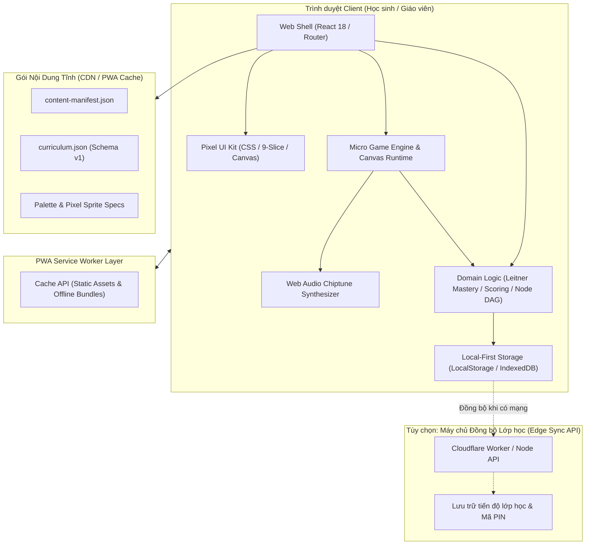

# 03-architecture.md — Kiến trúc hệ thống toàn diện EasyTin

> **Tài liệu hợp nhất chuỗi 4 Agent:** Architect · Engineer · Reviewer · Optimizer  
> **Phiên bản:** v1.0.0

---

## 1. Sơ đồ kiến trúc tổng thể (Architect)



---

## 2. Đặc tả giao tiếp & Hợp đồng dữ liệu (Engineer)

### 2.1 Interface Game Engine chung (`GameTemplateContract`)
```typescript
export interface GameSessionConfig {
  nodeId: string;
  template: string;
  seed: number;
  params: Record<string, unknown>;
  onProgress: (event: GameEvent) => void;
  onComplete: (result: GameResult) => void;
}

export interface GameResult {
  nodeId: string;
  score: number; // 0.0 to 1.0
  passed: boolean;
  timeSpentSeconds: number;
  hintsUsed: number;
  misconceptions: string[];
}

export interface GameEvent {
  type: 'action' | 'hint' | 'mistake' | 'score_update';
  payload: Record<string, unknown>;
  timestamp: number;
}
```

### 2.2 Thuật toán Mastery Leitner 4 Hộp (`LeitnerMastery`)
- **Hộp 1:** Ôn lại sau 1 ngày (điểm đúng ≥ 80% chuyển lên Hộp 2; sai giữ Hộp 1).
- **Hộp 2:** Ôn lại sau 3 ngày (đúng chuyển lên Hộp 3; sai rớt về Hộp 1).
- **Hộp 3:** Ôn lại sau 7 ngày (đúng chuyển lên Hộp 4; sai rớt về Hộp 2).
- **Hộp 4 (Mastered):** Ôn củng cố sau 21 ngày.
- **Công thức tính độ thông thạo tổng:**  
  $$\text{Mastery Rate} = \frac{\sum (\text{Level} \times \text{Weight})}{\text{Total Nodes} \times 4} \times 100\%$$

---

## 3. Rà soát & Cải tiến (Reviewer & Optimizer)

### 3.1 Báo cáo Reviewer (Các phát hiện đã xử lý)
1. **[MAJOR-FIXED] Tránh Memory Leak khi hủy Canvas:** Thêm cơ chế `dispose()` bắt buộc cho game scene canvas và Web Audio Context khi chuyển bài học.
2. **[MAJOR-FIXED] Snap pixel khi màn hình tỷ lệ lẻ (125%, 150% DPI trên Windows):** Sử dụng `Math.floor` cho tọa độ vẽ canvas và CSS `transform: translateZ(0)` để giữ độ nét pixel sắc lẹm.
3. **[MINOR-FIXED] Phòng chống rò rỉ âm thanh:** Web Audio API tự động `suspend()` khi người dùng chuyển sang tab khác và resume khi quay lại.

### 3.2 Ngân sách hiệu năng (Optimizer)
- Dung lượng khởi động (JS/CSS ban đầu): **< 280 KB gzipped**.
- Dung lượng nạp bài học + game: **< 150 KB**.
- Mức tiêu thụ bộ nhớ RAM: **< 55 MB** trên trình duyệt Chrome/Edge.
- Thời gian hiển thị bài học đầu tiên (FCP): **< 0.8 giây** trên máy phòng tin học.
