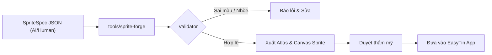

# 03b-art-system.md — Hệ thống đồ họa Pixel & UI Pixel-First EasyTin

> **Quy chuẩn mỹ thuật:** Pixel Art thuần khiết, Bảng màu khóa, Tương phản cao, Đầy đủ dấu tiếng Việt  
> **Toolchain:** `sprite-forge` (Dựng sprite từ spec JSON) + `validator` (Kiểm tra lỗi viền, màu ngoài bảng, bán trong suốt)

---

## 1. Art Direction Bible (Kinh thánh Mỹ thuật EasyTin)

### 1.1 Tôn chỉ thẩm mỹ
1. **Phong cách Nostalgic 16-bit:** Kết hợp nét cổ điển của hệ máy SNES/GameBoy Advance với sự trong sáng, tươi vui của giáo dục hiện đại.
2. **Không làm tổn hại khả năng đọc:** Pixel tôn vinh tính trực quan của game, nhưng tuyệt đối không biến chữ văn bản thành các đốm mờ. Chữ tiếng Việt luôn sắc nét 100%.
3. **Mascot TinTin:** Chú robot máy tính màn hình CRT đội mũ tai bèo phiêu lưu, có 4 trạng thái cảm xúc: Vui sướng (khi học sinh làm đúng), Suy nghĩ (khi làm bài), Động viên (khi làm sai), và Hào hứng vung cờ chiến thắng.

### 1.2 Bảng màu chuẩn khóa: Endesga 32
Tất cả asset trên EasyTin chỉ được sử dụng tối đa trong tập hợp 32 màu sau (kèm 8 màu UI bổ trợ):
- Nền đất & Rừng: `#181425`, `#262b44`, `#3a4466`, `#5a6988`, `#8b9bb4`, `#c0cbdc`
- Cây cỏ & Sinh lực: `#193c3e`, `#2b5c3f`, `#38b764`, `#a7f070`
- Năng lượng & Vàng: `#733e39`, `#b86f50`, `#e4a672`, `#eed39b`, `#ffcd75`, `#ef7d57`
- Mạng & Băng giá: `#2f142f`, `#561b36`, `#842b4b`, `#cb4763`, `#ea57b2`, `#ff7978`
- Trí tuệ & Công nghệ: `#1b1f3b`, `#283569`, `#416aa3`, `#73eff7`, `#94e344`

---

## 2. Đặc tả UI Kit Pixel-First

1. **Khung viền 9-Slice Pixel:**  
   Các thẻ (Card) và Hộp thoại (Dialog) sử dụng viền đôi pixel dày 2px - 4px với bóng đổ cứng 1 hướng (Dưới-Phải), không dùng blur shadow hiện đại.
2. **Nút bấm Pixel 5 trạng thái:**  
   - Normal: Viền nổi 3D, nền màu chủ đạo.
   - Hover: Sáng hơn 1 tone màu trong bảng Endesga 32, con trỏ đổi thành bàn tay pixel.
   - Active (Nhấn): Thụt xuống 2px, đổi bóng ngược tạo cảm giác phím cơ thật.
   - Focus: Vòng bao pixel vàng rực rỡ, nhìn rõ ở khoảng cách 2 mét.
   - Disabled: Chuyển sang tone xám bạc `#5a6988`, không nhận tương tác.
3. **Bộ Icon Pixel 16x16 & 32x32:**  
   Trái tim sinh lực, Ngôi sao thông thạo, Bánh răng cài đặt, Loa âm thanh, Cuốn sách tri thức, Robot TinTin, Mũi tên điều hướng, Cúp vô địch.

---

## 3. Quy trình tự động hóa Sprite-Forge & Kiểm thử Asset

