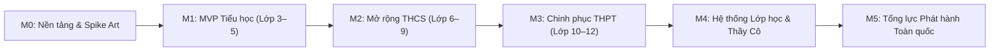

# 05-roadmap.md — Lộ trình triển khai & Backlog EasyTin

> **Chiến lược:** Phát hành lát cắt dọc sớm (Vertical Slice) -> Mở rộng cấp Tiểu học -> THCS -> THPT -> Công cụ cho Thầy Cô.

---

## 1. Danh sách các Mốc phát triển (Milestones M0 – M5)

| Mốc | Tên mốc | Thời gian | Định nghĩa hoàn thành (DoD) |
|---|---|---|---|
| **M0** | **Spike Art & Core Engine** | Tuần 1 | Xong bộ khung monorepo, engine canvas 2D, bộ tổng hợp âm thanh Web Audio, toolchain `sprite-forge`, 1 bài mẫu chạy mượt. |
| **M1** | **MVP Tiểu học (Lớp 3–5)** | Tháng 1 | Hoàn thiện Thế giới 1 (Thung lũng Số hóa), 4 khuôn game (`sort-drag`, `block-maze`, `type-run`, `match-memory`), lưu tiến độ Leitner. |
| **M2** | **Mở rộng THCS (Lớp 6–9)** | Tháng 2 | Hoàn thiện Thế giới 2 (Rừng Mạng & Dữ liệu), thêm khuôn game `logic-puzzle`, `sheet-quest`, `branch-story`. |
| **M3** | **Chinh phục THPT (Lớp 10–12)** | Tháng 3 | Hoàn thiện Thế giới 3 (Thành phố Thuật toán), tích hợp `bug-hunt`, `py-sandbox`, trận đấu trùm `boss-quiz`. |
| **M4** | **Cổng Giáo viên & Đồng bộ Lớp học** | Tháng 4 | Tạo mã lớp không cần email, bảng theo dõi độ thông thạo, phân tích lỗ hổng kiến thức học sinh. |
| **M5** | **Phát hành PWA & Đóng gói Ngoại tuyến** | Tháng 5 | Tối ưu dung lượng < 500KB, kiểm thử trên 10 cấu hình máy cũ, bản chạy offline từ USB cho trường học. |

---

## 2. Backlog 30 ngày đầu (Sprint Backlog chi tiết)

### Epic 1: Nền tảng Monorepo & UI Pixel Kit
- `ST-01`: Cài đặt Monorepo với Vite, React, TypeScript, Tailwind CSS.
- `ST-02`: Xây dựng component Pixel Frame 9-slice, Pixel Button, Progress Bar, Dialog.
- `ST-03`: Tích hợp bộ font tiếng Việt sắc nét và bitmap font retro.
- `ST-04`: Lập trình Web Audio Synthesizer phát 5 âm thanh chiptune (click, jump, correct, wrong, victory).

### Epic 2: Core Domain & Data Layer
- `ST-05`: Xây dựng module tính điểm và thuật toán ôn tập lặp lại ngắt quãng Leitner 4 hộp.
- `ST-06`: Xây dựng Local-First Storage Adapter bọc IndexedDB / LocalStorage có cơ chế fallback.
- `ST-07`: Viết schema validator JSON cho chương trình học và bài tập.

### Epic 3: 8 Khuôn Game Pixel
- `ST-08`: Hoàn thiện khuôn game `sort-drag` (kéo thả linh kiện phần cứng, thiết bị vào/ra).
- `ST-09`: Hoàn thiện khuôn game `block-maze` (ghép lệnh robot vượt mê cung).
- `ST-10`: Hoàn thiện khuôn game `logic-puzzle` (công tắc nhị phân và cổng logic).
- `ST-11`: Hoàn thiện khuôn game `type-run` (đua tốc độ gõ phím tiếng Việt).
- `ST-12`: Hoàn thiện khuôn game `branch-story` (tình huống an toàn số và đạo đức mạng).
- `ST-13`: Hoàn thiện khuôn game `bug-hunt` (tìm và sửa lỗi thuật toán).
- `ST-14`: Hoàn thiện khuôn game `boss-quiz` (trận chiến trùm kiến thức tổng hợp).

### Epic 4: Giao diện Học sinh & Thầy cô
- `ST-15`: Xây dựng Bản đồ 3 Thế giới Pixel tương tác chọn khối lớp 3–12.
- `ST-16`: Xây dựng Màn hình bài học 6 bước (Hook -> Concept -> Game -> Quiz -> Recap).
- `ST-17`: Xây dựng Hộp ôn tập thông minh (Leitner Review Dashboard).
- `ST-18`: Xây dựng Bảng điều khiển Giáo viên (Tạo lớp, nhập mã phòng, thống kê kết quả).
