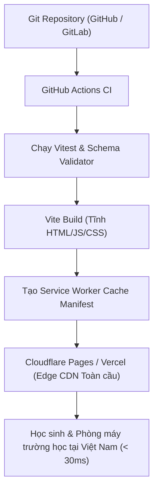

# 06-production.md — Sẵn sàng Production & Vận hành 5 năm EasyTin

> **Mục tiêu:** Vận hành bền bỉ với chi phí gần bằng 0, không đòi hỏi đội ngũ DevOps chuyên trách, an toàn bảo mật tuyệt đối.

---

## 1. Kiến trúc Hạ tầng & Triển khai (Infrastructure as Code)

- **Môi trường:** 100% Static Web Application (Jamstack). Không có máy chủ web server truyền thống để quản lý.
- **CDN:** Cloudflare Pages có điểm PoP (Point of Presence) trực tiếp tại Hà Nội và TP.HCM, đảm bảo độ trễ thấp nhất cả nước.
- **Chi phí dự toán 5 năm:**
  - Băng thông Cloudflare Pages: **Miễn phí không giới hạn (Free Tier)**.
  - Tên miền `.vn` hoặc `.edu.vn`: ~300.000 – 500.000 VNĐ / năm.
  - Tổng ngân sách hạ tầng: **< 50.000 VNĐ / tháng**.

---

## 2. Kim tự tháp Kiểm thử (Testing Pyramid)

1. **Unit Tests (Tầng đáy - 70%):**  
   Kiểm thử toàn bộ logic thuần túy trong `packages/domain`: thuật toán Leitner, chuyển đổi hệ số nhị phân, tính điểm bài học, chuẩn hóa chuỗi tiếng Việt.
2. **Schema & Content Validation Tests (20%):**  
   Tự động quét toàn bộ file JSON trong `content/` để đảm bảo không có link gãy, cấu trúc chuẩn schema, id nút không trùng lặp, bài học có đủ câu hỏi và đáp án đúng.
3. **Integration & E2E Tests (10%):**  
   Kiểm thử luồng người dùng: Chọn lớp -> Mở bài học -> Chơi hoàn thành game -> Nhận sao và lưu vào bộ nhớ cục bộ.

---

## 3. Bản cam kết chất lượng dịch vụ theo Giờ học (School-Hours SLO)

- **Thời gian phục vụ trọng điểm:** 07:00 – 17:30 các ngày Thứ Hai đến Thứ Bảy.
- **SLO Khả dụng (Availability):** 99.95% trong giờ học.
- **SLO Tốc độ (Speed):** Tải trang và tương tác dưới 1.5 giây trên kết nối mạng trường học băng thông 10 Mbps chia cho 40 máy tính.
- **SLO Khôi phục (Recovery):** Khả năng chuyển đổi dự phòng tức thì sang bản USB Offline nếu phòng máy trường mất kết nối Internet hoàn toàn.

---

## 4. Kế hoạch Pre-mortem: 10 Điểm có thể vỡ và Cách phòng ngừa

1. **Học sinh xóa cache trình duyệt làm mất tiến độ:**  
   *Giải pháp:* Thêm tính năng "Mã Thẻ Tiến Độ" (dãy 6 chữ số ngắn gọn) để học sinh ghi vào vở và nhập lại bất kỳ lúc nào.
2. **Trường học dùng màn hình CRT hoặc LCD tỷ lệ vuông 4:3 đời cũ (1024x768):**  
   *Giải pháp:* Thiết kế giao diện responsive linh hoạt, game canvas tỷ lệ 16:9 tự động căn giữa và thêm viền pixel retro hai bên (pillarbox).
3. **Bộ gõ Unikey / EVKey gõ đè chữ khi chơi game phím:**  
   *Giải pháp:* Sử dụng sự kiện `compositionend` và `input` chuẩn của trình duyệt, không chặn phím thô vô cớ.
4. **Bản quyền hình ảnh khi dùng AI sinh asset:**  
   *Giải pháp:* 100% asset được sinh bằng mã procedural hoặc lưới pixel vector trong bảng màu Endesga 32, không dùng mô hình diffusion sao chép tác phẩm người khác.
5. **Đổi mới sách giáo khoa trong tương lai:**  
   *Giải pháp:* Hệ thống bám chuẩn Yêu cầu cần đạt cốt lõi của Chương trình GDPT 2018; chỉ cần cập nhật trường `textbook_mapping` trong JSON khi có sách mới.
